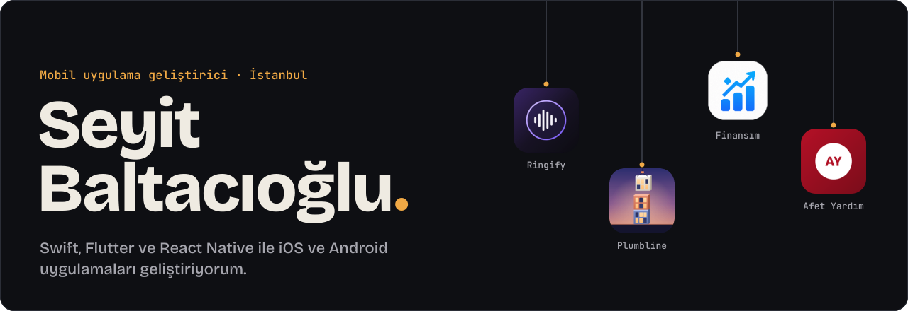
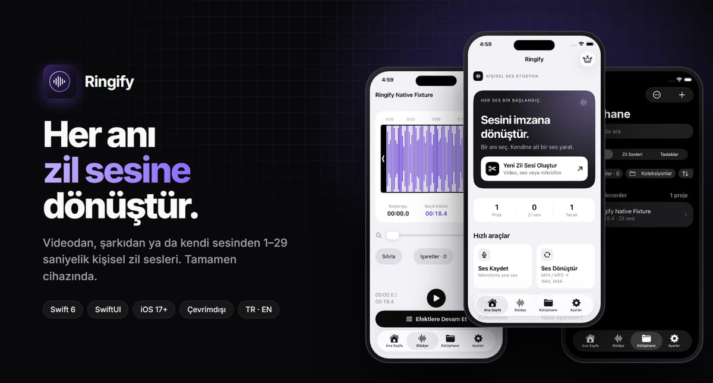
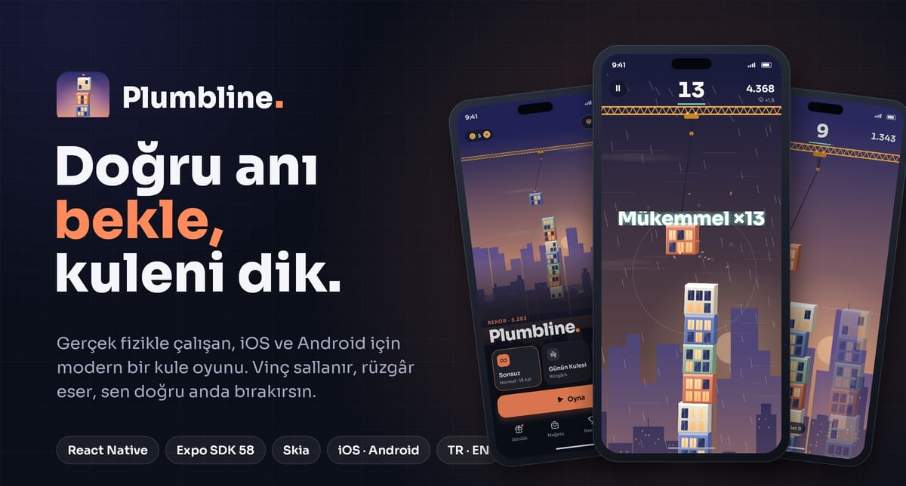
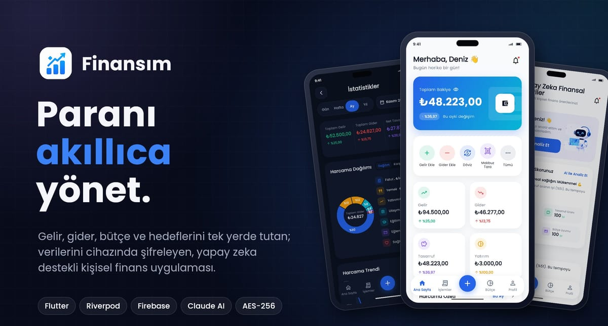
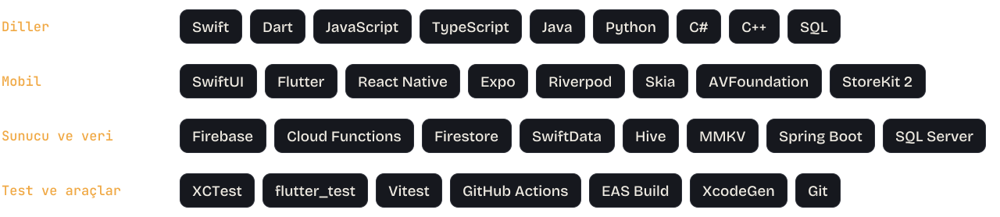
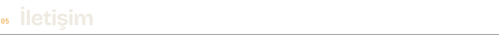

<a href="https://geniuseyis.github.io"><picture><source media="(prefers-color-scheme: dark)" srcset="assets/hero-dark.svg"><source media="(prefers-color-scheme: light)" srcset="assets/hero-light.svg"></picture></a>

<a href="https://geniuseyis.github.io"><picture><source media="(prefers-color-scheme: dark)" srcset="assets/btn-portfolyo-dark.svg"><source media="(prefers-color-scheme: light)" srcset="assets/btn-portfolyo-light.svg"></picture></a>
<a href="https://www.instagram.com/babyodaonduty/"><picture><source media="(prefers-color-scheme: dark)" srcset="assets/btn-instagram-dark.svg"><source media="(prefers-color-scheme: light)" srcset="assets/btn-instagram-light.svg"></picture></a>

 

<picture><source media="(prefers-color-scheme: dark)" srcset="assets/title-01-dark.svg"><source media="(prefers-color-scheme: light)" srcset="assets/title-01-light.svg"></picture>

İstanbul'da yaşıyorum. Swift, Flutter ve React Native ile iOS ve Android uygulamaları geliştiriyorum. Üç şeye dikkat ediyorum:

- **Veri cihazda kalır.** Mümkün olan her şeyi cihazda işliyor, yerel veriyi AES-256 ile şifreliyorum.
- **Platformun diliyle konuşur.** Apple HIG, 44 pt dokunma alanları, Dynamic Type ve VoiceOver.
- **Çalıştığı testle görünür.** Ürün kurallarını arayüzden ayırıyor, birim testleriyle koruyorum.

 

<picture><source media="(prefers-color-scheme: dark)" srcset="assets/title-02-dark.svg"><source media="(prefers-color-scheme: light)" srcset="assets/title-02-light.svg"></picture>

### Ringify
iOS · ses stüdyosu

Bir videodan, şarkıdan ya da kendi sesinden 1–29 saniyelik iPhone zil sesleri hazırlayan, çevrimdışı çalışan bir ses stüdyosu. Tüm ses işleme cihazda yapılıyor; hesap, analitik ya da izleme yok.

**136 birim testi ve uçtan uca arayüz akışı · Swift 6 tam katı eşzamanlılık**
 Swift 6 · SwiftUI · AVFoundation · SwiftData · StoreKit 2 · Sırada cihaz testi ve App Store

<a href="https://github.com/geniuseyis/ringify"><picture><source media="(prefers-color-scheme: dark)" srcset="assets/btn-depo-dark.svg"><source media="(prefers-color-scheme: light)" srcset="assets/btn-depo-light.svg"></picture></a>

 

### Plumbline
iOS ve Android · fizik oyunu

Vinçte sallanan katı doğru anda bırakıp kuleni yükselttiğin, gerçek fizikle çalışan bir kule oyunu. Motor deterministik: aynı seed ve aynı bırakma anları hep aynı skoru veriyor, kayıtlar baştan oynatılıp doğrulanabiliyor.

**120 Hz sabit adımlı fizik · AES-256 şifreli kayıtlar · hesap ve sunucu yok**
 React Native · Expo SDK 58 · TypeScript · Skia · Reanimated · Sırada mağaza entegrasyonu

<a href="https://github.com/geniuseyis/CityStacker"><picture><source media="(prefers-color-scheme: dark)" srcset="assets/btn-depo-dark.svg"><source media="(prefers-color-scheme: light)" srcset="assets/btn-depo-light.svg"></picture></a>

 

### Finansım
iOS ve Android · kişisel finans

Gelir, gider, bütçe ve birikim hedeflerini tek yerde toplayan, verileri cihazda şifreleyen kişisel finans uygulaması. Makbuzları cihaz üzerinde okuyor, TCMB kurlarını çekiyor.

**113 birim testi, her push’ta CI · 25+ ekran · Clean Architecture**
 Flutter · Riverpod · Firebase · Hive · ML Kit · Sırada cihaz testi ve mağazalar

<a href="https://github.com/geniuseyis/finansim"><picture><source media="(prefers-color-scheme: dark)" srcset="assets/btn-depo-dark.svg"><source media="(prefers-color-scheme: light)" srcset="assets/btn-depo-light.svg"></picture></a>

 

### Afet Yardım Sistemi
iOS ve Android · gerçek zamanlı koordinasyon · kaynak kodu özel

Deprem ve sel gibi afetlerde afetzedeyi, gönüllüyü ve koordinatörü aynı gerçek zamanlı platformda buluşturan mobil uygulama.
 React Native · Expo SDK 54 · TypeScript · Firestore · Cloud Functions

 

<picture><source media="(prefers-color-scheme: dark)" srcset="assets/title-03-dark.svg"><source media="(prefers-color-scheme: light)" srcset="assets/title-03-light.svg"></picture>

<picture><source media="(prefers-color-scheme: dark)" srcset="assets/toolkit-dark.svg"><source media="(prefers-color-scheme: light)" srcset="assets/toolkit-light.svg"></picture>

 

<picture><source media="(prefers-color-scheme: dark)" srcset="assets/title-04-dark.svg"><source media="(prefers-color-scheme: light)" srcset="assets/title-04-light.svg"></picture>

<picture><source media="(prefers-color-scheme: dark)" srcset="https://raw.githubusercontent.com/geniuseyis/geniuseyis/output/github-snake-dark.svg"><source media="(prefers-color-scheme: light)" srcset="https://raw.githubusercontent.com/geniuseyis/geniuseyis/output/github-snake.svg"></picture>

 

<picture><source media="(prefers-color-scheme: dark)" srcset="assets/title-05-dark.svg"><source media="(prefers-color-scheme: light)" srcset="assets/title-05-light.svg"></picture>

<a href="https://geniuseyis.github.io"><picture><source media="(prefers-color-scheme: dark)" srcset="assets/btn-portfolyo-dark.svg"><source media="(prefers-color-scheme: light)" srcset="assets/btn-portfolyo-light.svg"></picture></a>
<a href="https://www.instagram.com/babyodaonduty/"><picture><source media="(prefers-color-scheme: dark)" srcset="assets/btn-instagram-dark.svg"><source media="(prefers-color-scheme: light)" srcset="assets/btn-instagram-light.svg"></picture></a>
<a href="https://github.com/geniuseyis"><picture><source media="(prefers-color-scheme: dark)" srcset="assets/btn-github-dark.svg"><source media="(prefers-color-scheme: light)" srcset="assets/btn-github-light.svg"></picture></a>
